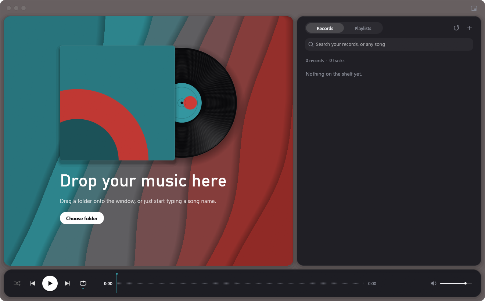

# Wax

A record-player style music player for Windows, written in Rust with [egui](https://github.com/emilk/egui).

Your collection sits on a shelf as album sleeves. Pick one and it plays on the platter, with a waveform strip along the bottom of the window.



## Download

Grab `wax.exe` from the [latest release](../../releases/latest) and run it. You don't need to install anything.

Windows SmartScreen may warn you because the exe isn't code-signed. Click **More info → Run anyway**.

## Using it

- **Add music:** click **+** on the shelf and pick a folder, or drag a folder onto the window. Wax scans it for audio files and remembers it.
- **Search:** start typing anywhere to search your collection. If nothing in your collection matches, press **Enter** to find the song on YouTube and stream it.
- **Keys:** `Space` play/pause · `←`/`→` seek 5 s · `Ctrl+←`/`Ctrl+→` previous/next · `↑`/`↓` volume

Streaming uses [yt-dlp](https://github.com/yt-dlp/yt-dlp). If Wax can't find it, it downloads the official `yt-dlp.exe` into `%LOCALAPPDATA%\wax` the first time you stream. Playing your own files works offline.

## Building

```bash
cargo build --release
```

The exe is written to `target/release/wax.exe`.
